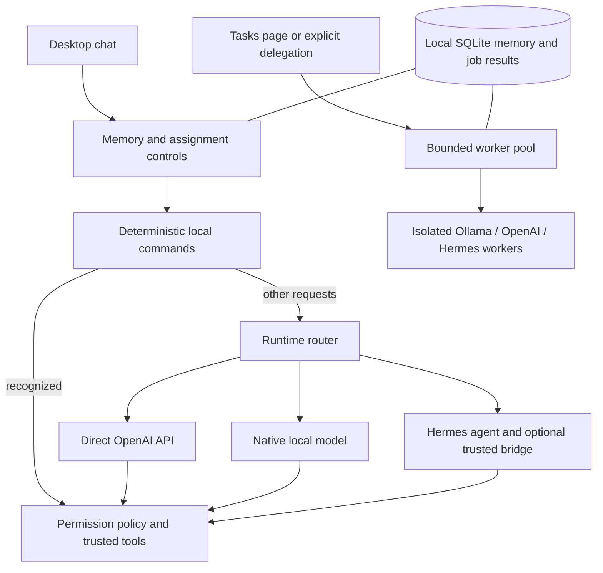

# JARVIS — Personal AI Desktop Assistant

A Windows desktop assistant combining deterministic PC commands, local Ollama models,
ChatGPT plan sign-in, API providers, Hermes, persistent personal memory, and independently
assigned agents. Ordinary cloud replies stream into the chat with a Stop control.

## Connect your ChatGPT plan or a free-tier API

Open **Settings → ChatGPT account → Continue with ChatGPT**. Review the browser consent,
then choose **ChatGPT plan** under Intelligence, load your account's models, and Apply.
Account eligibility and shared plan limits apply. This uses the official public
[Sign in with ChatGPT integration](https://developers.openai.com/siwc/token-sharing-open-source),
and is separate from OpenAI API billing. Manage credit permissions through ChatGPT's own
Usage settings; JARVIS does not enable credit spending or automatic purchases.

Alternatively, save a Groq, Gemini, OpenRouter, or OpenAI API key under **API connections**,
then select that source under Intelligence. Keys are encrypted for the current Windows
account. Groq and eligible Gemini accounts have free tiers; JARVIS cannot determine
whether you upgraded those accounts. OpenRouter's free-only option rejects paid model
IDs. A failed selected connection never falls back to a paid provider.

Gemini text replies use Google's native streaming API. Concise mode lowers thinking
effort on supported Gemini models. Tool requests retain the compatibility adapter.
Temporary Gemini HTTP 502/503/504 failures receive at most two extra API attempts per
chat request, with short cancellable waits. Retries keep the same model and connection;
completed PC/browser actions are not replayed. Other errors and partially streamed replies
are not automatically retried. Managed API approvals and daily request limits still apply.

**Appearance** offers light/dark themes. **Concise replies** reduces unnecessary output.
**Local only** blocks cloud requests. Older role and engine controls remain under
**Settings → Advanced model roles**. See [the research report](docs/FREE_AI_RESEARCH.md)
for sources, quota limitations, community evidence, and a suggested setup.

## Conversational task handling

The assistant now has a native animated orb, visible microphone/screen state,
captions, a collapsible conversation history and a movable desktop companion.
See [the visual interface guide](docs/ASSISTANT_VISUALS.md). This presentation
update does not establish reliability of live provider/browser tasks; reported
HTTP 400 screen requests remain under investigation.

Chat now has an active assistant card, short responses, and expandable result details.
Follow-ups use actual observed pages and presented source choices. Ambiguous targets are
clarified, and questions about what JARVIS just opened/read are answered locally.

Type a replacement instruction while a task is running to interrupt it and start the
new request after the old worker exits. Approvals appear inline and remain bound to the
exact waiting action. Text rendering is buffered, and the task card adapts to small windows.
Contextual searches now recover the earlier topic before opening a results page.
Video searches use YouTube, and the acknowledgment shows the actual query. Changing
AI modes preserves that context. See [the search correction and verification](docs/CONTEXTUAL_SEARCH.md).
Local speech and interruption controls are described in [the voice guide](docs/VOICE.md).
See [the interaction guide](docs/ASSISTANT_FLOW.md) for response and task handling.

## Browser navigation and web research

Tavily keyless search is connected for general research. Playwright MCP is now connected
inside JARVIS for isolated browser navigation, snapshots, and following observed links.
Check the connection in **Settings → Web research** and try:
`browser: Open https://www.python.org and find its contact information.`
The selected model plans the steps, and JARVIS checks browser permission before execution.
Forms, arbitrary clicks, uploads, and login automation are not exposed in this stage.
See [browser setup and the learning guide](docs/BROWSER_MCP.md).

## Approved API discovery

Open **API assistant** to research official provider offers, approve a connection, securely
save your own key, and verify an exact model before enabling it. Optional daily research,
approved failover/local fallback, request caps, and a product preview mode are included.
Management is opt-in; approvals expire after seven days or reviewed evidence changes.
The assistant supports reviewed adapters, not arbitrary automatic API installation.
It never registers accounts, accepts terms, purchases subscriptions, or enables billing.

Product preview excludes personal ChatGPT access and developer environment credentials.
Free quotas are account-dependent; request caps are not provider billing caps.
See [API assistant setup and product plan](docs/PROVIDER_ASSISTANT.md) for the workflow,
limitations, and the customer-owned-connection approach to a future commercial release.

## Automatic actions and reasoning

Recognized app launches, website navigation, and explicit browser searches execute locally
without a model call. Successful actions remain in the active conversation for follow-ups.
Automatic reasoning can use a previously selected Gemini, Groq, or OpenRouter-free model;
managed connections must be approved and active. Configure the API model once, then select
**Automatic · local actions + connected AI**. Local-only mode continues to block cloud use.
Complex action tasks can use explicitly configured cloud Hermes when management is off.
Unregistered model tool names produce recoverable feedback instead of a registry crash.

Browser search currently opens a search URL. Reading results and reliably targeting an
existing tab need a browser session connector. See [the architecture research and roadmap](docs/HYBRID_ASSISTANT_RESEARCH.md)
for the project comparison, videos, verified behavior, and remaining integration work.

## Background updates and draft review

Completed background jobs appear in **Updates**, with a persistent unread count, quiet
mode, review/dismiss controls, and a read-only preview on a selected connected display.
Reviewing a draft does not apply, publish, deploy, or send it. Background work runs while
JARVIS is open. Try `show updates` or `quiet mode on` in Chat.

See [the personal-assistant stages](docs/PERSONAL_ASSISTANT_STAGES.md) for the confirmed
Kokoro direction and the remaining voice, browser/project, business, and phone integrations.

## Read web sources and answer

Try **open google and see the stock market** or **research your topic**. JARVIS uses
an isolated research browser, reads up to three public pages, and answers with source
URLs and retrieval times. Search challenges and unreadable sources are disclosed.
Market pages are not a live quote feed. Stop can cancel browser navigation and direct
API network waits. See [setup, verification, and limits](docs/WEB_RESEARCH.md).

## Run

Requirements: Windows, Python 3.14+, and `uv`. Ollama and Hermes are optional for their
respective backends. An OpenAI API key is required for the older `chatgpt` API backend;
the new `plan` backend uses browser sign-in instead.

```powershell
cd C:\Users\salem\Jarvis
uv sync --locked
uv run python -m jarvis.ui
```

For this existing installation, the installed environment can also launch directly:

```powershell
.venv\Scripts\python.exe -m jarvis.ui
```

Keep your existing `.env`. Add the OpenAI settings from `.env.example` to that file;
do not replace your existing Hermes or other provider settings. Restart after editing.
Never commit real credentials. An API key may also be supplied as `OPENAI_API_KEY`.

In **Settings → Advanced model roles**, choose **Auto** as the agent engine when using
the older automatic routing. With an OpenAI key configured,
ordinary reasoning goes directly to OpenAI, avoiding Hermes startup overhead.
**Local** mode blocks cloud requests. Explicit Native/Hermes engine selections remain
overrides, so an older saved profile may need to be changed to Auto.

The direct API model is configurable with `JARVIS_OPENAI_MODEL`. The example uses
`gpt-4.1-mini`; it is a configurable starting point, not a claim about the newest model.
Select another OpenAI MAIN model in Models to change the direct reasoning model during
the session. Add an agent-specific model override in Tasks for independent workers.

## Try it

| Request or page | Behavior |
| --- | --- |
| `open notepad` | Runs through local tools without model inference |
| `Could you please open calculator?` | Uses the same local path |
| `Explain SQL joins` | Direct OpenAI reasoning when configured and automatic routing is enabled |
| `@local Explain SQL joins` | Uses the local model |
| `@chatgpt Explain SQL joins` | Explicitly selects the separately billed OpenAI API |
| `@plan Explain SQL joins` | Uses the ChatGPT plan connection and its saved model |
| `@groq Explain SQL joins` / `@gemini Explain SQL joins` / `@free Explain SQL joins` | Uses the specified API connection |
| `@hermes Help me complete this task` | Explicitly selects Hermes with the trusted action bridge |
| `remember learning_goal = Spring Boot and SQL` | Saves a preference locally |
| `show memory` / `forget learning_goal` / `clear memory` | Inspects or removes personal context |
| `assign coder to chatgpt` | Creates or reassigns a named worker |
| `delegate to coder: Explain dependency injection` | Queues an independent job |
| `parallel: chatgpt: Explain SQL joins || hermes: Draft a Java learning plan` | Starts two independent jobs |
| `list tasks` / `task <id>` / `cancel task <id>` | Checks results or cancels a queued job |

**Tasks** is the graphical version of agent assignment: name the agent, choose its
backend, optionally set its model and instructions, then assign work. Up to three jobs
run concurrently, with a bounded queue. Changes to an agent apply to future jobs.
Each job uses separate context; completed results and assignments survive a restart.
Interrupted jobs are marked as interrupted and are never silently rerun.

**Memory** lets you inspect, edit, and remove personal facts and view recent chat
context. JARVIS retains the last 12 chat exchanges and passes a bounded selection of
context to new chats. Preferences are saved explicitly; it does not infer a permanent
profile from every message. Facts and recent context are local, but selected context
is transmitted when you choose a cloud backend. Never store passwords or API keys.
Forgetting a fact also clears recent context and the active model conversation to
prevent an old copy of the preference being reused. Starting a New Chat retains
personal memory. Clearing personal memory does not delete agent task history.

## Architecture



Providers only generate responses or tool requests. JARVIS retains permission checks,
confirmation decisions, and tool execution. Background workers draft and reason
without PC action tools; perform Windows actions through the main chat. Concurrent
agents do not fight over the keyboard or share an active conversation. A task named
"research" does not gain web browsing tools automatically.

Durable personal memory, agent definitions, and task results are stored in
`%APPDATA%\Jarvis\personal_memory.sqlite3`, separately from source and API credentials.
Unit tests use isolated in-memory or temporary stores.

ChatGPT OAuth tokens and Settings API keys are kept separately in
`%APPDATA%\Jarvis\connections.dpapi`, protected by Windows DPAPI. They are never stored in
personal memory, runtime profiles, or job records. Model discovery does not count as a
successful inference test; real account authorization and a completed response must be
verified after connecting.

## Validation

```powershell
uv run ruff check .
uv run pyright --pythonpath .venv\Scripts\python.exe
uv run pytest
```

Tests cover routing, tool permissions, model contracts, persistent memory, actual
worker concurrency, queue cancellation, restart interruption, error isolation,
context separation, and desktop assignment controls. Cloud calls are mocked in tests.

## Current limits and next steps

- API and model quality still depend on the chosen provider/model. Worker concurrency
  does not make one small local model faster; multiple local inference jobs can compete
  for the same RAM/GPU.
- Queued jobs can be cancelled. Running requests finish or hit their provider timeout.
  The desktop waits for active jobs before closing.
- Agent assignment is explicit. Dependency pipelines, automatic delegation, synthesis
  of several worker results, and token/spend limits are future additions.
- Optional voice uses local Kokoro speech and Whisper recognition through Pipecat
  services in a separate Python 3.13 process. Enable **Voice replies**, wait for
  **Voice ready**, then click **Talk** and **Send**. Voice settings also offers
  optional hold-to-talk and hands-free pause detection. The microphone is off
  at startup. See [the voice guide](docs/VOICE.md).
- **Allow Jarvis to see my screen** follows the active app without an app picker.
  Vision models receive an image during requested tasks; known text-only models
  use Windows accessibility controls. General tools observe, act and inspect again.
  Simple local opening/search stays independent of the AI connection even with
  screen access enabled. See [the screen assistant guide](docs/SCREEN_ASSISTANT.md).
- Main-chat streaming supports cooperative Stop. A stalled network read can take up to
  its timeout to release; completed actions are not undone. Background task cancellation
  still applies to queued jobs.

Hands-free settings now include **Interrupt by speaking · speaker echo cancellation**.
Voice activity pauses work and stops old audio; a correction redirects the same
conversation. “Wait” holds a task and “continue” resumes it. Copy buttons and
Ctrl+C use verified Windows clipboard copying.

Suggested next order: evaluate speaker echo rejection and interruption with your
real devices and room acoustics. Measure 10
realistic tasks for quality, first-text latency and quota behavior; create a short
demo and architecture walkthrough for the portfolio.

OpenAI integration follows the existing Chat Completions provider abstraction:
[official API reference](https://developers.openai.com/api/reference/resources/chat/subresources/completions/methods/create).
