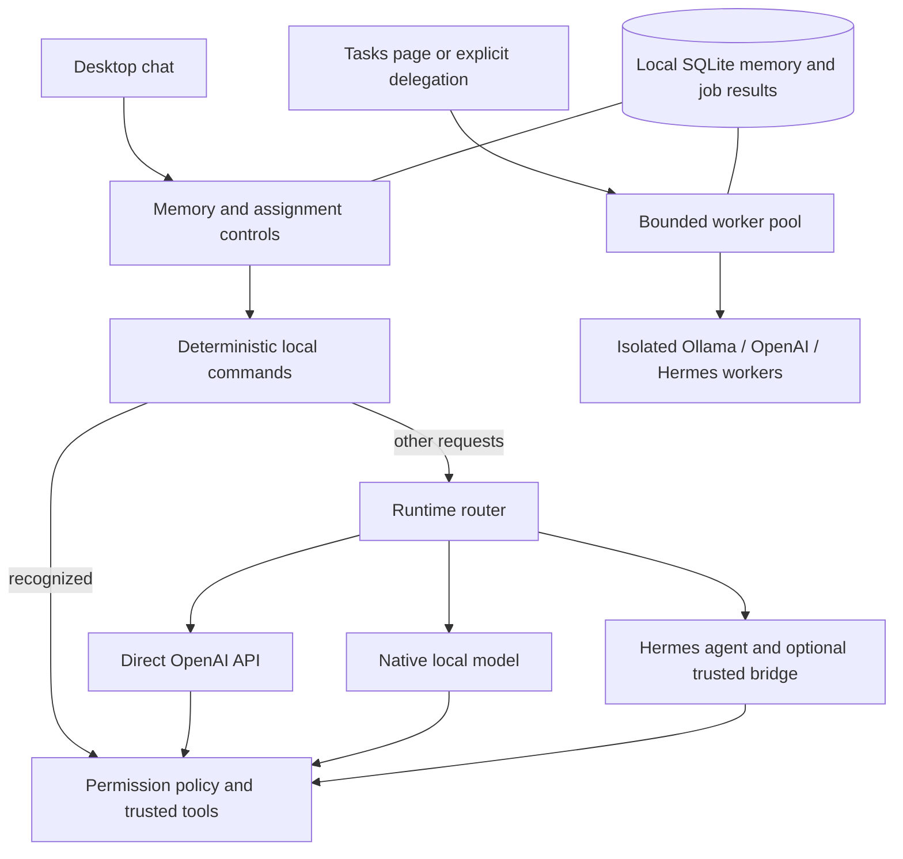

# JARVIS — Personal AI Desktop Assistant

A Windows desktop assistant combining deterministic PC commands, local Ollama models,
the OpenAI API, Hermes, persistent personal memory, and independently assigned agents.

## Run

Requirements: Windows, Python 3.14+, and `uv`. Ollama and Hermes are optional for their
respective backends. An OpenAI API key is required for the `chatgpt` backend.

```powershell
cd C:\Users\salem\Jarvis
uv sync --locked
uv run python -m jarvis.ui
```

For this existing installation, the installed environment can also launch directly:

```powershell
.venv\Scripts\python.exe -m jarvis.ui
```

Keep your existing `.env`. Add the OpenAI settings from `.env.example` to that file;
do not replace your existing Hermes or other provider settings. Restart after editing.
Never commit real credentials. An API key may also be supplied as `OPENAI_API_KEY`.

In **Models**, choose **Auto** as the agent engine. With an OpenAI key configured,
ordinary reasoning goes directly to OpenAI, avoiding Hermes startup overhead.
**Local** mode blocks cloud requests. Explicit Native/Hermes engine selections remain
overrides, so an older saved profile may need to be changed to Auto.

The direct API model is configurable with `JARVIS_OPENAI_MODEL`. The example uses
`gpt-4.1-mini`; it is a configurable starting point, not a claim about the newest model.
Select another OpenAI MAIN model in Models to change the direct reasoning model during
the session. Add an agent-specific model override in Tasks for independent workers.

## Try it

| Request or page | Behavior |
| --- | --- |
| `open notepad` | Runs through local tools without model inference |
| `Could you please open calculator?` | Uses the same local path |
| `Explain SQL joins` | Direct OpenAI reasoning when configured and automatic routing is enabled |
| `@local Explain SQL joins` | Uses the local model |
| `@chatgpt Explain SQL joins` | Explicitly selects the OpenAI API |
| `@hermes Help me complete this task` | Explicitly selects Hermes with the trusted action bridge |
| `remember learning_goal = Spring Boot and SQL` | Saves a preference locally |
| `show memory` / `forget learning_goal` / `clear memory` | Inspects or removes personal context |
| `assign coder to chatgpt` | Creates or reassigns a named worker |
| `delegate to coder: Explain dependency injection` | Queues an independent job |
| `parallel: chatgpt: Explain SQL joins || hermes: Draft a Java learning plan` | Starts two independent jobs |
| `list tasks` / `task <id>` / `cancel task <id>` | Checks results or cancels a queued job |

**Tasks** is the graphical version of agent assignment: name the agent, choose its
backend, optionally set its model and instructions, then assign work. Up to three jobs
run concurrently, with a bounded queue. Changes to an agent apply to future jobs.
Each job uses separate context; completed results and assignments survive a restart.
Interrupted jobs are marked as interrupted and are never silently rerun.

**Memory** lets you inspect, edit, and remove personal facts and view recent chat
context. JARVIS retains the last 12 chat exchanges and passes a bounded selection of
context to new chats. Preferences are saved explicitly; it does not infer a permanent
profile from every message. Facts and recent context are local, but selected context
is transmitted when you choose a cloud backend. Never store passwords or API keys.
Forgetting a fact also clears recent context and the active model conversation to
prevent an old copy of the preference being reused. Starting a New Chat retains
personal memory. Clearing personal memory does not delete agent task history.

## Architecture



Providers only generate responses or tool requests. JARVIS retains permission checks,
confirmation decisions, and tool execution. Background workers draft and reason
without PC action tools; perform Windows actions through the main chat. Concurrent
agents do not fight over the keyboard or share an active conversation. A task named
"research" does not gain web browsing tools automatically.

Durable personal memory, agent definitions, and task results are stored in
`%APPDATA%\Jarvis\personal_memory.sqlite3`, separately from source and API credentials.
Unit tests use isolated in-memory or temporary stores.

## Validation

```powershell
uv run ruff check .
uv run pyright --pythonpath .venv\Scripts\python.exe
uv run pytest
```

Tests cover routing, tool permissions, model contracts, persistent memory, actual
worker concurrency, queue cancellation, restart interruption, error isolation,
context separation, and desktop assignment controls. Cloud calls are mocked in tests.

## Current limits and next steps

- API and model quality still depend on the chosen provider/model. Worker concurrency
  does not make one small local model faster; multiple local inference jobs can compete
  for the same RAM/GPU.
- Queued jobs can be cancelled. Running requests finish or hit their provider timeout.
  The desktop waits for active jobs before closing.
- Agent assignment is explicit. Dependency pipelines, automatic delegation, synthesis
  of several worker results, and token/spend limits are future additions.
- Voice, streamed text, and a full redesign are not included in this change.

Suggested next order: measure 10 realistic tasks for quality and latency; add streamed
responses and running-task cancellation; add voice with interruption; then create a
short demo and architecture walkthrough for the portfolio.

OpenAI integration follows the existing Chat Completions provider abstraction:
[official API reference](https://developers.openai.com/api/reference/resources/chat/subresources/completions/methods/create).
