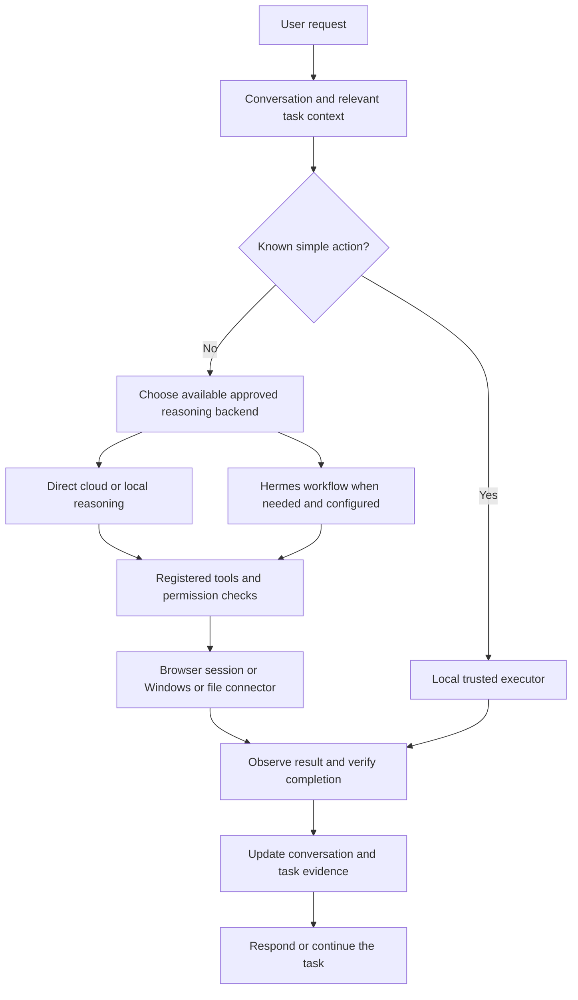

# How JARVIS should work: research, diagnosis, and implementation plan

31 October 2026

The intended experience is one assistant: immediate execution of familiar PC commands, capable reasoning when needed, continuity between turns, and visible evidence that work was completed. The current failure is architectural. A different theme or an extra model cannot compensate for missing browser capabilities, disconnected context, or a router that sends the wrong work to a small CPU model.

## What failed in your screenshot

`open google` used a trusted local command and succeeded. The follow-up `search for how can i make money fast in the google you opened` had no deterministic search route. Automatic mode fell back to Qwen 3.5 4B. That model proposed `google_search`, which was not registered. The executor correctly had no such tool, but the agent failed to turn the missing-tool condition into corrective feedback. The UI showed 74.1 seconds before the failure.

There was another continuity problem: successful fast commands were saved in action memory and recent personal history, but were not appended to the active model conversation. Once a conversation already existed, the next model turn could miss the action it was supposed to refer to.

These are reproducible integration defects, not a reason for you to find a special prompt.

## What the researched projects teach us

| Project or reference | Useful design | Decision for JARVIS |
| --- | --- | --- |
| [Home Assistant Assist](https://www.home-assistant.io/blog/2025/02/13/voice-chapter-9-speech-to-phrase/) | Handles understood commands locally, passes other requests to an LLM, and shares conversation history between those paths. | Keep a fast action path and one continuous conversation. |
| [Hermes Agent](https://github.com/NousResearch/hermes-agent) and its [tool documentation](https://hermes-agent.nousresearch.com/docs/user-guide/features/tools) | Separates the agent runtime from configured model providers and real toolsets. Web search and browser control are specific capabilities. | Treat Hermes as an orchestrator with an actual backend and tool inventory. Installation alone does not supply every capability. |
| [Hermes memory](https://hermes-agent.nousresearch.com/docs/user-guide/features/memory) | Uses bounded persistent notes and a user profile. | Keep preferences compact and inspectable. Retrieve relevant task records rather than sending an unlimited chat archive. |
| [Hermes delegation](https://hermes-agent.nousresearch.com/docs/user-guide/features/delegation) | Child agents work in separate contexts and return results to a coordinator. | Delegate independent work with explicit inputs and outputs; keep shared browser actions under one owner. |
| [Browser Use](https://github.com/browser-use/browser-use) and its [browser configuration](https://github.com/browser-use/browser-use/blob/main/skills/open-source/references/browser.md) | Operates a real browser session and supports an existing browser connection through CDP. | Add a real browser connector with tab identity and page observation. Opening a URL cannot provide that information. |
| [Anthropic: Building effective agents](https://www.anthropic.com/research/building-effective-agents) | Recommends simple composable workflows, routing, and added complexity when it helps task performance. | Use the shortest successful route. Measure whether an extra agent improves the result enough to justify its latency. |
| [Open Interpreter](https://github.com/openinterpreter/openinterpreter) | Its current repository is a coding agent with model harnesses and computer-use integrations. | Check the current implementation before copying an old desktop-assistant demo. Borrow interfaces and verification practices rather than replacing JARVIS wholesale. |

My recommendation is to keep the existing Python/PySide desktop application and improve its execution architecture. A wholesale rewrite would discard useful permission handling, local actions, and tests without resolving the central design decisions.

## The target pipeline

This diagram is the proposed full architecture. The browser session connector and complete research workflow are still future work; the current implementation status is listed below.

### 1. Execute familiar commands immediately

Examples include opening Chrome, navigating to a known website, and opening a search URL for an explicit query. These should be recognized locally and executed through the existing permission system. They need no LLM startup, GPU, model download, or cloud token.

The first performance target is less than 300 milliseconds for command interpretation and dispatch. Browser launch/render time is a separate measurement. That number is a proposed target, not a claim that Chrome always opens in 300 milliseconds.

### 2. Use capable reasoning after the fast path declines

Questions, ambiguity, writing, and planning should normally use the configured cloud reasoning connection on the CPU-only laptop. On a GPU PC, the user can select a suitable local model instead. Hardware suitability and measured tool-calling reliability should guide that choice.

Hermes can coordinate longer action workflows when its model backend and required tools are configured. It should not be started for every greeting or obvious navigation command. A cloud model can plan an action while Windows executes it locally; the location of execution and the location of reasoning are separate decisions.

Do not promise that a small CPU model will deliver the same planning quality or latency as a stronger hosted model. Also do not automatically switch accounts or turn on paid usage after an error. Provider failover remains a separate approved policy.

### 3. Give the browser worker real state

The next important integration is a session-aware browser backend, using one chosen implementation such as Playwright/CDP through a controlled MCP adapter. It should expose operations such as list tabs, navigate a tab, read a page, click an observed element, and extract links. Start with an assistant-owned browser profile; offer an explicitly authorized existing-browser connection later.

A browser task should retain a session ID, tab ID, last observed URL/title, requested goal, and evidence of the last successful action. If the user says "the tab you opened," use that identifier and re-observe the tab. Do not guess from a window title or assume that old action memory proves the current page.

Distinguish two requests: "search for X" can open a search URL; "research X and compare sources" must retrieve sources, read them, retain URLs, compare evidence, and produce an answer supported by those sources. The latter is a longer task with progress and cancellation.

### 4. Separate preferences, conversation, and task state

The proposed memory structure has four stores: user-approved preferences; a bounded active conversation; structured task state and observed actions; and retrieved project/source records. Each record should have an origin and timestamp. A remembered preference can guide presentation, but cannot grant permission or prove that a browser page is still open.

The user should be able to inspect and delete stored personal facts. Research pages and external files remain untrusted data even when a model reads them. Useful repeated workflows can eventually become reviewed reusable skills, with a validation history before reuse.

### 5. Delegate only useful independent work

A coordinator could assign separate source reviews or implementation/review work, then reconcile the outputs. Workers need a goal, relevant context, tool access, a time/request budget, and a result format. Browser mutations need ownership so two workers cannot click in the same tab at once.

JARVIS already has independent workers. It does not yet have the complete coordinator, source-grounded research system, or shared-tab ownership described here. Adding more workers before those boundaries are clear would multiply failures.

### 6. Add voice to a working text pipeline

Voice should feed the same router: speech recognition produces text, familiar actions execute immediately, reasoning streams, and speech output begins from usable text. Measure recognition delay, routing delay, time to first model text, and time to first audio separately. Add interruption and cancellation before promoting voice as an always-ready assistant.

## Changes implemented during this investigation

- Explicit Google, Bing, DuckDuckGo, and YouTube search commands now use the zero-model browser-navigation path. The exact follow-up from your screenshot is covered by a regression test.
- Contextual searches can use the last recorded search website. The existing browser opener may create a new tab; this version does not guarantee reuse of an existing tab and does not read its contents.
- Successful local commands now enter the active conversation before the next reasoning turn.
- Unknown or unoffered model tool names are rejected before execution and returned as structured corrective feedback. Retries are bounded by the existing agent loop limit. Permission denial and declined confirmation remain final.
- Automatic mode can use a previously selected Gemini, Groq, or OpenRouter-free connection for reasoning. It does not treat an arbitrary newly discovered key as a configured automatic connection. Managed mode requires active model approval.
- Complex PC action requests can use Hermes automatically when a supported cloud backend/model is explicitly configured and Hermes is available. This external cloud runtime remains blocked under API management because that manager cannot enforce its separate configuration. A generic installed Hermes executable is insufficient.
- Explicit Local-only and engine overrides are respected. The sidebar identifies the connected automatic reasoning source instead of always showing the legacy local MAIN model.

To configure this once: select your working cloud source/model in Settings and Apply, then choose **Automatic · local actions + connected AI** and Apply again. Local commands will still run first. With managed connections, approve and enable the model in API assistant before selecting Automatic. Personal ChatGPT and separately billed OpenAI API access remain explicit connection choices rather than newly inferred automatic choices.

## What remains, in order

1. **Browser integration:** stable sessions, tab selection, observation, and click/read tools. Acceptance: open Google, search in the same known tab, read two results, report their titles and URLs, then stop without fabricating a page observation.
2. **Research task runner:** source collection, extraction, evidence tracking, progress, cancellation, and bounded recovery. Acceptance: compare three real sources and cite their actual contents.
3. **Task memory and coordinator:** resume a task, retrieve relevant preferences, delegate independent work, and verify the combined output.
4. **Voice:** run the same five workflows by speech and measure latency and interruption behavior.
5. **Portfolio release:** a clean installation, documented architecture, reproducible workflow checks, measured latency, and a short uncut demonstration. Demonstrate supported behavior and show failures clearly.

Before adding more interface polish, use a fixed acceptance set: open an app; open a contextual search; ask a follow-up about a completed local action; perform a multi-step browser task with evidence; and complete a research task with source citations. Test the exact text from failed sessions as regressions.

## Verification and its limits

The full suite passes **334 tests**. The exact screenshot sequence also passes through the real application routing and permission executor in an offscreen desktop regression replay. Browser opening is mocked and both local-model inference and cloud-provider creation are configured to fail if called for that sequence. No model calls occur. The measured dispatches were approximately **1.02 ms** and **0.98 ms**. Those measurements exclude real browser launch and page rendering.

The tests cover context continuity, permission denial, Local-only routing, automatic API selection, configured Hermes dispatch, managed-provider restrictions, unknown-tool recovery, and existing behavior. They do not prove arbitrary website automation or unlimited natural-language understanding. Static checks pass separately. No new model inference was needed for these regressions.

## Videos and further study

These are relevant original creator resources, not evidence that this laptop will match a demo's speed:

- [Home Assistant: Voice - Chapter 9](https://www.youtube.com/watch?v=k6VvzDSI8RU), from the Home Assistant team, accompanies the local-command/shared-history design above.
- [Tonbi's AI Garage: Hermes Agent Masterclass 1 — Installation, Setup, Basic Commands](https://www.youtube.com/watch?v=R3YOGfTBcQg).
- [Tonbi's AI Garage: Hermes Agent Masterclass 8 — Subagents & Delegation](https://www.youtube.com/watch?v=_6DtQkDpcEs).

I checked the available video titles/descriptions and the corresponding project documentation. Full video playback/transcripts were not accessible through the research tools, so I have not claimed to watch or reproduce those demonstrations. The implementation decisions above rely on the linked primary documentation, local code inspection, and regression checks.
