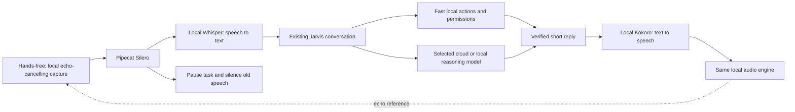

# Jarvis local voice

For the current listening and screen-action controls, see
[Voice, browser and screen actions](SCREEN_ASSISTANT.md).

Restart Jarvis after updating. In Chat:

1. Tick **Voice replies**. Wait for **Voice ready** (models load once per session).
2. Open **Voice settings**, choose your microphone and speaker/headphones, and
   press **Test voice** to hear Kokoro. George is the default British voice;
   Daniel and Heart are also available. Speed is adjustable.
3. Click **Talk**, say “Open Google,” then click **Send**. Your recognized words appear
   in the conversation. Jarvis runs the normal action flow and speaks its short
   result. Any action approvals still appear on screen.
4. For automatic turn sending, choose **Voice mode → Hands-free · pause to send**
   in Voice settings and click **Listen**. Speak, then pause briefly; Jarvis sends
   the utterance. Leave **Interrupt by speaking · speaker echo cancellation** on
   to keep listening while Jarvis speaks or works. This is the same conversation, memory, provider
   and permissions as typing. Typed requests also receive spoken replies while
   voice is enabled. Long answers and source lists stay in chat/details.
5. **Hold to talk** remains optional under Voice mode. **Stop voice**
   stops recording/playback and silences the current reply; **Stop** also cancels
   the active chat request. Completed actions are not undone.

The microphone is off at startup. In click/hold modes, messages are capped at
20 seconds; pressing Stop discards them. In hands-free mode, listening starts
only when you click Listen, and a roughly 0.6-second pause sends each utterance.
With interruption enabled, capture and playback share a local Chromium audio
engine using WebRTC echo cancellation. Speaking stops old playback and pauses
the current task at its next cooperative check. After the pause in your speech,
Whisper transcribes the correction and Jarvis redirects the task using its
existing conversation and observed app/browser state. Completed actions are not
replayed or automatically undone. Say **wait** to hold the task and **continue**
to resume the same task. Stop voice ends microphone access. No wake word is used.
If you disable the interruption option, the earlier mode pauses microphone
capture during reasoning/playback. Click/hold modes remain available.

After playback, a short cooldown and recent-speech echo filter reduce repeated
self-transcription. A failed or partly completed request normally pauses hands-free
mode and speaks the explanation once. An AI rate limit keeps hands-free mode
available for local commands while the provider's wait time runs down.
“Can you hear me?” is answered locally from the actual input source and does not
depend on a cloud model. Jarvis includes requested values in its spoken summary;
longer evidence and technical details remain available in chat.
Final speech replaces unfinished progress speech. Late audio from that older
generation is discarded, so it cannot overwrite or overlap the result.

## What runs where



Pipecat 1.15.0 supplies Kokoro, Whisper and Silero voice activity detection.
Qt handles click/hold recording and playback. Interruptible hands-free uses an
isolated, temporary QWebEngine page served only on loopback. Its microphone asks
for echo cancellation, noise suppression and automatic gain control. The page
requests all-output echo cancellation where supported. Older embedded Chromium
uses a local pair of RTC peers to render synthesized output as call audio, which
its echo canceller can use as a reference. Both peers run on this computer with
no STUN/TURN server; microphone input is never added to that relay. Only this
local page can receive microphone permission, only after
Listen; Stop voice stops its media tracks. The page has no AI keys or action tools.
Pipecat Silero detects utterance boundaries locally. Streaming partial recognition
and wake words remain future work.
The supplied Pipecat ZIP was used as
reference; the runtime installs a pinned release instead of executing the ZIP.

Raw microphone audio and synthesized speech stay on this computer and in memory.
The recording is discarded after transcription. Recognized text is sent through
your chosen Jarvis route: a cloud model can receive that text and conversation
context. Local speech itself uses no API key or paid speech credits. Usual model
provider limits still apply to cloud reasoning.

The speech process has no API credentials or PC action tools. Jarvis retains
control of the conversation and approvals. A spoken “yes” does not grant an
approval. Old audio and transcripts carry generation numbers and are discarded
after interruption. Native inference finishes safely in the separate process;
its old result cannot resume playback or execute a command.

## Setup on another Windows machine

The desktop remains on Python 3.14. Kokoro ONNX currently needs Python below 3.14,
so speech uses `.voice-venv` with Python 3.13. From the project folder:

```powershell
.\scripts\setup_voice.ps1
```

Setup installs pinned speech packages and downloads about 268 MB of models into
`.voice-models`: quantized Kokoro, its voice bank and Whisper base.en (English,
CPU int8). These local folders are ignored by Git. Runtime uses local paths and
offline model mode; it never installs packages or downloads models automatically.

To check the installed speech loop without using microphone, speakers or an API:

```powershell
.venv\Scripts\python.exe scripts\check_voice.py
```

This checks actual Qt process communication, Kokoro generation, Whisper command
recognition, replacement and microphone-off behavior. Hardware recording and
playback still need a real-device test. Normal `pytest` uses isolated voice
fixtures and does not open audio devices or download speech models.

The opt-in `scripts/check_voice_redirection.py` check uses Chromium's generated
microphone input and muted playback with actual Kokoro/Whisper and the real Qt
worker. It checks the actual Copy button against another Windows process,
one-link navigation, interruption during speech/work and returning through the
same browser's history. These relative navigation operations use observed state
without cloud inference. Room acoustics and real device echo rejection still need
a physical test; the echo-cancellation setting alone cannot prove those results.

An approved real-device check on November 3, 2026 used the Cirrus Logic laptop
microphone array and speakers. The final live measurement observed no speech
onset during the generated sentence, and local transcription did not recover
the sentence from the microphone. A startup VAD event was observed separately;
its source was not established. This check does not establish reliable human
barge-in under every room/noise condition. Only metrics were retained, not raw
audio or ambient transcripts. `scripts/check_speaker_echo.py --real-devices`
requires explicit consent before running; it opens physical devices briefly.

If input fails, select a microphone in Voice settings, refresh devices after
connecting it, and check Windows Settings → Privacy & security → Microphone →
desktop app access. The **Windows microphone access** button opens this page;
turn on Microphone access, Let apps access your microphone, and Let desktop
apps access your microphone. **Windows sound settings** opens the input/output
device controls. Windows access is separate from Jarvis action permissions.
If output fails, select the intended speaker/headphones.
For a setup error, run setup again, then toggle voice off and on.

The first release incorrectly compared legacy `QAudio` enums with the
`QtAudio` enums returned by Qt 6.11. A successful `NoError` status compared
unequal and immediately closed both microphone and speaker. This is fixed;
regression tests use actual Qt error enums without opening audio devices.

## Measured on this laptop

The local smoke test on November 2, 2026 measured startup at 2.93 s; first audio
for a warm short command reply at 0.21 s; and local transcription at 0.64–0.69 s
on three synthesized English examples. These are component measurements, not a
promise for accented/noisy real recordings or the complete cloud response time.
Click/hold modes wait for sending/release before transcription; hands-free mode
waits for the detected pause. Brief action progress can be spoken while work
continues, followed by the structured final reply. The model does not yet think
from partial audio.

Sources: [Pipecat](https://github.com/pipecat-ai/pipecat),
[Kokoro ONNX](https://github.com/thewh1teagle/kokoro-onnx),
[Kokoro model](https://github.com/hexgrad/kokoro),
[Faster Whisper](https://github.com/SYSTRAN/faster-whisper).
